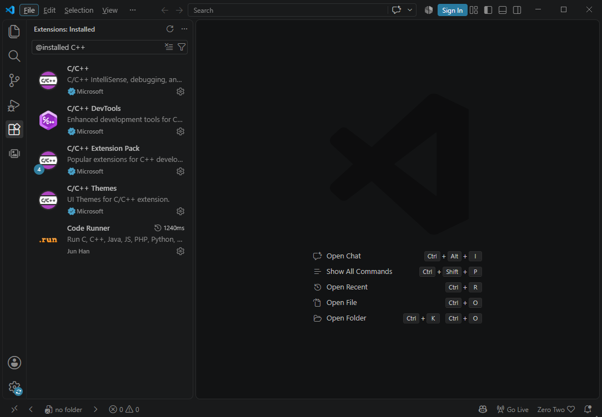
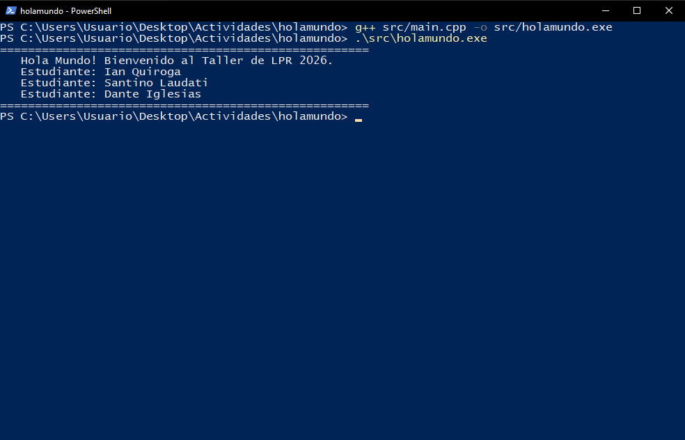

# 1. Propósito del documento

Este manual explica cómo preparar el entorno de desarrollo (VS Code + MSYS2/GCC), cómo está organizado el proyecto **holamundo** y cómo compilarlo, ejecutarlo y modificarlo. Sirve como guía de referencia para configurar cualquier PC del grupo.

# 2. Instalación del entorno

## 2.1 Compilador (MSYS2 – UCRT64)

1. Descargar e instalar MSYS2 desde https://www.msys2.org/ en `C:\msys64`.
2. En la terminal **MSYS2 UCRT64** ejecutar:

```bash
pacman -Syu
pacman -S mingw-w64-ucrt-x86_64-gcc
```

3. Agregar `C:\msys64\ucrt64\bin` a la variable de entorno **Path** de Windows.
4. Reiniciar VS Code y verificar con `g++ --version`.

## 2.2 Extensiones de VS Code

| Extensión | Editor | Función |
|---|---|---|
| C/C++ | Microsoft | IntelliSense, resaltado y depuración |
| C/C++ Extension Pack | Microsoft | Herramientas de navegación y depuración |
| Code Runner | Jun Han | Ejecutar el archivo con un clic (opcional) |



# 3. Estructura del repositorio

```
holamundo/
├── .gitignore          # ignora .vscode/ y *.exe
├── LICENSE             # MIT uso escolar
├── README.md
├── docs/               # informe APA + manuales
├── src/main.cpp        # programa principal
└── capturas/           # gpp_version, extensiones_vscode, ejecucion_hola_mundo
```

# 4. Descripción del código

| Línea / bloque | Explicación |
|---|---|
| `#include <iostream>` | Biblioteca estándar de entrada/salida (`cout`, `cin`). |
| `using namespace std;` | Evita escribir `std::` antes de cada instrucción. |
| `int main()` | Punto de entrada del programa; el sistema operativo lo ejecuta primero. |
| `cout << ... << endl;` | Muestra texto en consola y hace un salto de línea. |
| `return 0;` | Informa a Windows que el programa terminó con éxito. |

# 5. Compilación y ejecución

```powershell
# Desde la raíz de la carpeta holamundo
g++ src/main.cpp -o src/holamundo.exe
.\src\holamundo.exe
```



# 6. Solución de problemas

| Síntoma | Causa | Solución |
|---|---|---|
| `g++ no se reconoce como comando` | El compilador no está en el Path | Agregar `C:\msys64\ucrt64\bin` al Path y reiniciar VS Code |
| `No such file or directory` | Se ejecutó desde otra carpeta | Pararse en la raíz `holamundo` antes de compilar |
| Caracteres raros en la consola | Tildes y eñes en `cout` | Escribir los mensajes de consola sin tildes |
| PC del laboratorio bloqueada | Sin permisos de administrador | Usar OnlineGDB y guardar la captura |

# 7. Guía de mantenimiento

- Cada integrante debe figurar en la salida por pantalla (regla anticopia).
- No subir ejecutables al repositorio: el `.gitignore` excluye `*.exe`.
- Mantener el punto de entrada siempre en `src/main.cpp`.
